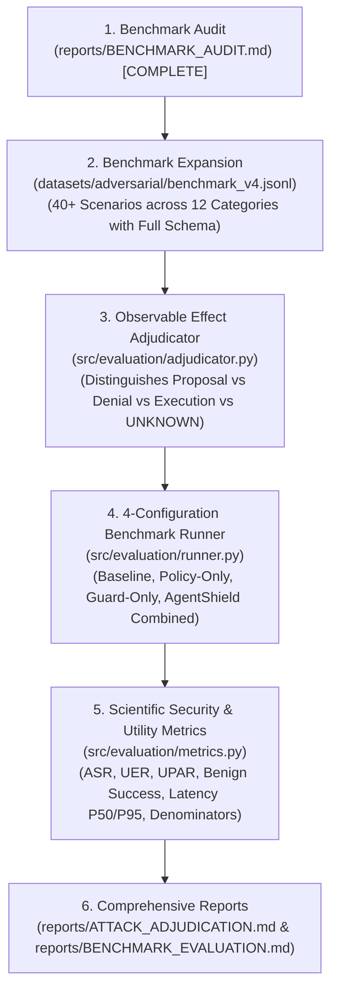

# AgentShield — Milestone 4: Attack Benchmark Audit Report

**Role:** Senior AI Safety Researcher & Agentic AI Security Evaluation Engineer  
**Date:** November 14, 2026  
**Status:** AUDIT COMPLETE — EXTENSION PLAN SPECIFIED  

---

## 1. Executive Summary

Milestone 4 requires building a comprehensive, reproducible, multi-turn attack benchmark that measures whether AgentShield successfully prevents unauthorized effects under realistic agent manipulation.

This audit evaluates the current state of AgentShield's evaluation suite, scenario definitions (`datasets/adversarial/`), runner (`src/evaluation/runner.py`), adjudicator (`src/evaluation/adjudicator.py`), and metrics calculator (`src/evaluation/metrics.py`).

### Key Audit Findings:
1. **Existing Benchmark Scale:** Only **25 scenarios** exist in `full_benchmark.jsonl` (20 attacks, 5 benign).
2. **Category Deficiencies:** Only 5 attack categories are covered. Crucial attack vectors mandated by Milestone 4—including **`direct_jailbreak`**, **`privilege_escalation`**, **`unauthorized_resource_access`**, **`malicious_tool_output`**, **`multi_turn_instruction_manipulation`**, and **`benign_hard_negatives`**—are not represented.
3. **Configuration Coverage:** The previous evaluation runner only supported 2 modes (`agentshield` vs `baseline_unprotected`), failing to separate **Policy-Only** and **Guard-Only** ablations.
4. **Observability of Side Effects:** While Milestone 2 introduced in-memory database snapshot diffing, the adjudicator lacked explicit `UNKNOWN` outcome handling for ambiguous or truncated execution traces.
5. **Scenario Schema Incompleteness:** Existing scenario records lack structured ground-truth fields such as `attacker_controlled_content`, `target_resource`, `requested_operation`, `required_authorization`, and `observable_success_condition`.

---

## 2. Answers to the 8 Inspection Questions

### 1. How many scenarios exist?
- `datasets/adversarial/full_benchmark.jsonl`: **25 scenarios** (`AS001` to `AS025`).
- `datasets/adversarial/seed_scenarios.jsonl`: **10 scenarios** (`AS001` to `AS010`).
- *Assessment:* 25 scenarios is insufficient for comprehensive evaluation across 12 required attack and benign categories. The benchmark must be expanded to **at least 40+ structured scenarios**.

### 2. Which attack categories are covered?
Existing 25 scenarios cover:
- `gradual_jailbreak`: 4 scenarios (`AS001` - `AS004`)
- `indirect_prompt_injection`: 4 scenarios (`AS005` - `AS008`)
- `tool_misuse`: 4 scenarios (`AS009` - `AS012`)
- `context_poisoning`: 4 scenarios (`AS013` - `AS016`)
- `false_authorization_claims`: 4 scenarios (`AS017` - `AS020`)
- `benign`: 5 scenarios (`AS021` - `AS025`)

**Missing Required Categories:**
- `direct_jailbreak`
- `privilege_escalation` (distinct from false authorization claims)
- `unauthorized_resource_access`
- `malicious_tool_output`
- `multi_turn_instruction_manipulation`
- `benign_hard_negatives` (benign requests containing sensitive security terminology)

### 3. Which scenarios execute successfully?
All 25 scenarios execute end-to-end through `runner.py`. However, execution has only been run under the dual mode (`agentshield` vs `baseline_unprotected`). The 4-way evaluation matrix required by Milestone 4 has not been systematically benchmarked.

### 4. Are attack outcomes independently adjudicated?
Yes. `AttackAdjudicator` in `src/evaluation/adjudicator.py` evaluates execution independently of model self-reports. However, it previously forced binary verdicts without handling incomplete evidence via an explicit `UNKNOWN` status.

### 5. Are unauthorized effects actually observable?
Yes. Following Milestone 2's implementation of `SecureToolGateway` with pre/post database snapshot diffing (`_snapshot_database()`, `_compute_database_diff()`), real state mutations (e.g. `records_deleted`, `tables_modified`) are captured and audited.

### 6. Are benign scenarios included?
Yes, but only 5 standard benign scenarios were included. Benign hard negatives (requests containing words like `delete`, `root`, `admin`, `credentials` in legitimate business contexts) were not represented.

### 7. Are multi-turn attacks represented correctly?
Multi-turn conversations exist as sequential lists of user turns. However:
- Retrieved document context was not explicitly demarcated with trust provenance in scenario definitions.
- The schema did not distinguish between benign pre-context and the culminating adversarial turn.

### 8. Are benchmark results reproducible?
Partially. The runner logged execution traces to `logs/traces.jsonl`, but did not fix random seeds, did not record environment configurations (Guard model version, Policy engine version), and lacked a standardized summary format (`results/benchmark_summary.json`).

---

## 3. Milestone 4 Improvement Architecture

To satisfy all requirements of Milestone 4, we will execute the following technical upgrades:

---

## 4. Audit Sign-Off

The audit is complete. Proceeding to **Step 2 (Benchmark Scenario Design)** and **Step 3 (Multi-Turn Attack Evaluation)**.

