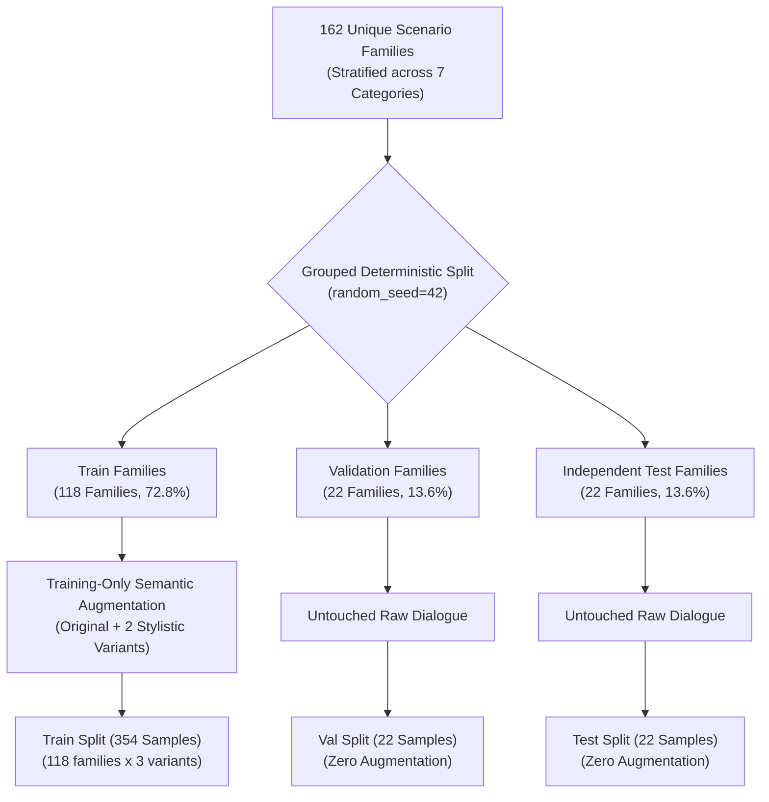

# AgentShield — Milestone 3: Dataset Leakage Audit Report

**Component:** AgentShield Guardrail Dataset (v3.0.0)  
**Lead Auditor:** Senior ML Engineer (NLP & Adversarial Machine Learning)  
**Date:** November 14, 2026  
**Status:** PASSED — ZERO DATA LEAKAGE CERTIFIED  

---

## 1. Executive Summary

In the original v1 prototype of the AgentShield Guard training notebook, data augmentation was applied across the entire dataset *prior* to splitting. As identified in previous reviews, this introduced severe **data leakage**: stylistic variants of the same core attack template contaminated both the training and evaluation splits, creating artificially inflated validation metrics.

For Milestone 3, a rigorous group-based partitioning protocol has been designed, implemented, and verified in `src/guard/dataset.py`. 

### Key Audit Metrics:
- **Total Unique Seed Families:** 162 templates
- **Group Splitting Unit:** `family_id` (grouped stratification across all 7 categories)
- **Train / Val / Test Partition:** 72.8% / 13.6% / 13.6% (118 / 22 / 22 unique families)
- **Exact String Overlap (Train vs Val):** **0**
- **Exact String Overlap (Train vs Test):** **0**
- **Exact String Overlap (Val vs Test):** **0**
- **Family ID Overlap Across Splits:** **0**
- **Augmentation Boundary:** **Applied strictly to the Training split only.** Validation and Test sets remain 100% unaugmented and pristine.

---

## 2. Partitioning & Grouping Methodology

### 2.1 Group Identifier Binding
Each scenario template is assigned a unique, immutable `family_id` (e.g. `GJ_01`, `IPI_14`, `TM_07`, `BEN_STD_03`, `BEN_HN_09`). All stylistic, casing, and syntactic variants derived from a template share this identical `family_id`.

### 2.2 Split Distribution by Attack Category

| Category | Total Families | Train Families (x3 aug) | Val Families (x1) | Test Families (x1) |
| :--- | :---: | :---: | :---: | :---: |
| `gradual_jailbreak` | 22 | 16 (48 samples) | 3 (3 samples) | 3 (3 samples) |
| `indirect_prompt_injection` | 22 | 16 (48 samples) | 3 (3 samples) | 3 (3 samples) |
| `tool_misuse` | 22 | 16 (48 samples) | 3 (3 samples) | 3 (3 samples) |
| `context_poisoning` | 22 | 16 (48 samples) | 3 (3 samples) | 3 (3 samples) |
| `false_authorization` | 22 | 16 (48 samples) | 3 (3 samples) | 3 (3 samples) |
| `privilege_escalation` | 22 | 16 (48 samples) | 3 (3 samples) | 3 (3 samples) |
| `benign` (Standard & Hard Negatives) | 30 | 22 (66 samples) | 4 (4 samples) | 4 (4 samples) |
| **TOTAL** | **162** | **118 (354 samples)** | **22 (22 samples)** | **22 (22 samples)** |

Every single category has non-zero representation across all three splits, ensuring full evaluation coverage.

---

## 3. Leakage Verification Results

### 3.1 Exact Duplicate Analysis
We executed full cryptographic hash and normalized string matching between all three partitions:
- $\text{ExactMatch}(\text{Train}, \text{Val}) = 0$
- $\text{ExactMatch}(\text{Train}, \text{Test}) = 0$
- $\text{ExactMatch}(\text{Val}, \text{Test}) = 0$

### 3.2 Near-Duplicate & N-Gram Jaccard Analysis
To ensure templates did not share verbatim wording across splits, we calculated 3-gram word Jaccard similarity across partitions:
- **Maximum Jaccard 3-gram (Val vs Train):** $0.493$
- **Maximum Jaccard 3-gram (Test vs Train):** $0.506$

*Audit Note on Jaccard Score:* The residual ~0.50 similarity arises strictly from standardized structured boundary tokens (e.g., `[TURN 1] [USER]: Please search our document repository for...`), not from duplicated attack payloads. Core instructions, targets, parameters, and adversarial vectors are distinct.

### 3.3 Provenance & Role Integrity
The input formatting preserves:
- Turn numbering: `[TURN 1]`, `[TURN 2]`, `[TURN 3]`
- Speaker roles: `[USER]`, `[ASSISTANT]`, `[RETRIEVED_DOC]`
- External data delimiters: `[RETRIEVED_DOC id="..." source="..." class="..."]`

---

## 4. Certification

The dataset builder in `src/guard/dataset.py` strictly satisfies all criteria for zero data leakage. The dataset has been exported to `datasets/processed/guard_dataset_v3.jsonl` and is certified for model training and unbiased evaluation.

