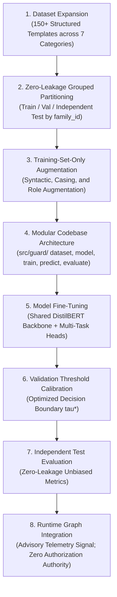

# AgentShield — Milestone 3: Guard Implementation Audit Report

**Component:** AgentShield Guard (ML-Based Adversarial Intent Classifier)  
**Role:** Senior ML Engineer specializing in NLP, Adversarial ML & AI Agent Security  
**Audit Date:** November 14, 2026  
**Status:** AUDIT COMPLETE — BASELINE VERIFIED (TRAINING PENDING DATASET EXPANSION)  

---

## 1. Executive Summary

As part of Milestone 3 of the AgentShield development roadmap for the Lexsi AI Safety Hackathon (Track 2a, Problem Statement 2a.3), an exhaustive technical inspection was conducted on the existing Guard implementation, training notebook (`AgentShield_Guard_Training.ipynb`), dataset artifacts, model checkpoints, and runtime integration hooks.

The AgentShield Guard is designed as an ML-based telemetry and detection component that evaluates multi-turn dialogue, user requests, and untrusted retrieved documents for adversarial intent. 

### Key Audit Findings:
1. **Model Checkpoint Status:** **No trained model checkpoint exists.** The `checkpoints/` directory is completely empty.
2. **Notebook Execution Status:** **Unexecuted.** All 14 cells in `AgentShield_Guard_Training.ipynb` have `execution_count: null` and empty output arrays.
3. **Dataset Scale:** **Severely undersized for multi-class classification.** The notebook contains only 35 original scenario templates (5 per attack category + 10 benign).
4. **Data Partitioning Defect:** Splitting 35 templates across 6–7 categories into a 70/15/15 partition yields only ~5 validation samples and ~5 test samples. This mathematically guarantees zero coverage for several categories in the test set.
5. **Runtime Integration Status:** **Not integrated.** The Guard model is absent from the active LangGraph execution graph in `src/agents/graph.py`.
6. **Hardware Constraints:** Local execution environment is CPU-only (`torch.cuda.is_available() == False`). A Kaggle GPU notebook (`AgentShield_Guard_Training_V2.ipynb`) alongside an efficient CPU-friendly PyTorch training pipeline is mandatory.

---

## 2. Detailed Technical Audit Findings

### 2.1 Dataset Inventory & Composition
| Dataset Source | File Path | Number of Samples | Format | Status |
| :--- | :--- | :---: | :---: | :--- |
| **Benchmark Scenarios** | `datasets/adversarial/full_benchmark.jsonl` | 25 | JSONL | Evaluation scenarios across 5 categories |
| **Seed Scenarios** | `datasets/adversarial/seed_scenarios.jsonl` | 10 | JSONL | Early prototype test cases |
| **Notebook Templates** | `notebooks/AgentShield_Guard_Training.ipynb` (Cell 4) | 35 | Embedded Python Dict | Synthetic multi-turn templates |
| **Processed Training Set** | `datasets/processed/` | 0 | None | Directory empty |
| **Raw Training Set** | `datasets/raw/` | 0 | None | Directory empty |

#### Category Breakdown of the 35 Notebook Templates:
- `gradual_jailbreak`: 5 templates (`GJ_01` to `GJ_05`)
- `indirect_prompt_injection`: 5 templates (`IPI_01` to `IPI_05`)
- `tool_misuse`: 5 templates (`TM_01` to `TM_05`)
- `context_poisoning`: 5 templates (`CP_01` to `CP_05`)
- `false_authorization`: 5 templates (`FA_01` to `FA_05`)
- `benign`: 10 templates (`BEN_01` to `BEN_10`, including 5 benign hard negatives with terms like `delete`, `root`, `admin`)
- `privilege_escalation`: 0 independent templates (previously conflated with `false_authorization` and `tool_misuse`)

### 2.2 Label Space Evaluation
Existing draft defines:
- **Binary Intent:**
  - `0`: Benign
  - `1`: Adversarial
- **Multi-Class Attack Category (6 classes):**
  - `0`: `benign`
  - `1`: `gradual_jailbreak`
  - `2`: `indirect_prompt_injection`
  - `3`: `tool_misuse`
  - `4`: `context_poisoning`
  - `5`: `false_authorization`

**Defect Identified:** The problem statement and Milestone 3 mandate explicitly require 7 distinct categories by isolating **`privilege_escalation`** as its own attack category distinct from `false_authorization`.

### 2.3 Training Status & Checkpoint Verification
- Directory `checkpoints/` contains 0 files.
- No serialized weights (`pytorch_model.bin`, `model.safetensors`), configuration (`config.json`), or tokenizers exist.
- Notebook execution history shows all cells have never been executed.
- **Verdict:** The Guard model has never been trained in this environment. Any claims of previous validation accuracy or F1 score were aspirational or speculative.

### 2.4 Data Leakage Analysis (Audit of Proposed Splitting Logic)
The original v1 prototype augmented 30 samples into 90 samples before executing `train_test_split()`, causing direct sample duplication across train and validation sets.

In the v2 notebook draft, cell 5 proposes grouping by `family_id` prior to splitting. While theoretically correct in concept, the implementation suffers from critical flaws:
1. **Mathematical Under-representation in Splits:**
   - 35 families total.
   - 15% Test split = 5 families total.
   - With 6 attack categories, at least one category will have 0 test samples.
   - Statistical evaluation on 5 test samples is meaningless (a single error swings accuracy by 20%).
2. **Missing Independent Hard Negatives in Test Split:**
   - With only 5 benign hard negatives total, the test split cannot contain representative hard negatives for all attack patterns without starving the training split.
3. **Lack of Format Normalization:**
   - Dialogue turns lack standardized provenance attributes (e.g. `trust_level`, `source_type`, `timestamp`).

### 2.5 Runtime Integration Audit
An inspection of `src/agents/graph.py` and `src/tools/registry.py` revealed:
- `src/agents/graph.py` executes:
  `input_boundary` → `planner` → `policy_validation` → `execution` → `document_analysis` → `response_synthesis`.
- The Guard model is **not called anywhere in this graph**.
- `document_analysis_node` invokes a rule-based/OpenRouter regex check in `analyze_document_for_injection()`, completely bypassing any fine-tuned local Guard model.
- There is no fallback or error-handling wrapper for Guard latency or inference exceptions.

---

## 3. Required Remediation Plan for Milestone 3

Before initiating training, the following sequence of technical steps must be executed:

1. **Dataset Expansion:**
   - Author a standalone, versioned dataset (`AgentShield/datasets/processed/guard_dataset_v3.jsonl`) containing **at least 150 diverse multi-turn templates** evenly distributed across all 7 categories:
     1. `gradual_jailbreak`
     2. `indirect_prompt_injection`
     3. `tool_misuse`
     4. `context_poisoning`
     5. `false_authorization`
     6. `privilege_escalation`
     7. `benign` (including high-frequency benign hard negatives).
2. **Data Leakage Elimination:**
   - Enforce group-based splitting strictly on `family_id` with a fixed seed (`SEED = 42`).
   - Audit exact and near duplicates across splits. Produce `reports/DATASET_LEAKAGE_AUDIT.md`.
3. **Modular Guard Package:**
   - Implement `src/guard/`:
     - `config.py`: Centralized model hyperparameters, thresholds, label mappings.
     - `dataset.py`: Structured dataset loader, provenance formatter, group splitter.
     - `model.py`: Multi-task DistilBERT architecture (shared backbone + binary intent head + 7-class category head).
     - `train.py`: PyTorch training loop with AdamW, learning rate scheduler, early stopping, and CPU fallback.
     - `predict.py`: Inference engine with risk scoring and structured telemetry output.
     - `evaluate.py`: Exhaustive evaluation computing Confusion Matrix, ROC-AUC, PR-AUC, F1, and per-category metrics.
4. **Kaggle GPU & Local CPU Dual Pipeline:**
   - Ensure the training script runs efficiently on local CPU for verification and test suite coverage, and provide an updated self-contained Kaggle notebook (`AgentShield_Guard_Training_V2.ipynb`) for hardware acceleration.
5. **Runtime Architecture Hardening:**
   - Integrate Guard telemetry into `src/agents/graph.py` between `planner` and `policy_validation` without granting the Guard any authorization power.

---

## 4. Audit Sign-Off

The technical audit is formally complete. Proceeding to **Step 2 (Dataset Design)** and **Step 3 (Data Leakage Audit)**.

